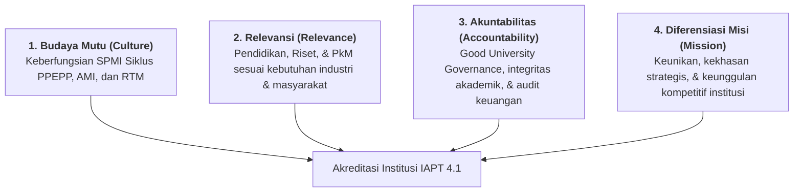

# PERATURAN BADAN AKREDITASI NASIONAL PERGURUAN TINGGI
## NOMOR 35 TAHUN 2025
### TENTANG INSTRUMEN AKREDITASI PERGURUAN TINGGI (IAPT 4.1) UNTUK STATUS TERAKREDITASI DAN STATUS TERAKREDITASI UNGGUL

---

## I. IDENTITAS REGULASI & LANDASAN HUKUM

* **Nomor Regulasi**: Peraturan BAN-PT Nomor 35 Tahun 2025
* **Ditetapkan di**: Jakarta, 1 Desember 2025
* **Oleh**: Majelis Akreditasi Badan Akreditasi Nasional Perguruan Tinggi
* **Ketua Majelis Akreditasi**: Prof. Dr.rer.nat. Imam Buchori, S.T.
* **Dasar Hukum Induk**: 
  1. Undang-Undang Nomor 12 Tahun 2012 tentang Pendidikan Tinggi.
  2. Peraturan Menteri Pendidikan Tinggi, Sains, dan Teknologi Republik Indonesia Nomor 39 Tahun 2025 tentang Penjaminan Mutu Pendidikan Tinggi (*Permendiktisaintek No. 39/2025* jo. No. 10/2026).
  3. Peraturan BAN-PT Nomor 20 Tahun 2025 tentang Sistem Akreditasi Nasional Pendidikan Tinggi (SAN Dikti).
  4. Peraturan BAN-PT Nomor 21 Tahun 2025 tentang Kebijakan Penyusunan Instrumen Akreditasi.
* **Status Instrumen**: Menggantikan dan menyempurnakan IAPT 4.0 menjadi **IAPT 4.1**.

---

## II. STRUKTUR BUKU PANDUAN IAPT 4.1

1. **Buku 1**: Naskah Akademik Instrumen Akreditasi Perguruan Tinggi (IAPT 4.1)
2. **Buku 2**: Kriteria, Indikator, Prosedur Asesmen, dan Penilaian Akreditasi
3. **Buku 3**: Sistem dan Acuan Penilaian Akreditasi Perguruan Tinggi (Tersedia per varian institusi, termasuk **PTS Akademik** untuk Sekolah Tinggi seperti STIMI YAPMI Makassar).

---

## III. PARADIGMA PENILAIAN & 4 KRITERIA UTAMA (CRAM)

IAPT 4.1 beralih sepenuhnya ke paradigma **Outcome-Based Accreditation (Berbasis Luaran dan Capaian Nyata)** dengan menekankan proporsi standar luaran (*output & outcome*) yang lebih besar dibandingkan masukan dan proses. Kriteria penilaian institusi dirangkum dalam model **CRAM**:

1. **Budaya Mutu (*Culture*)**: Kemampuan menumbuhkembangkan dan melaksanakan secara konsisten budaya peningkatan mutu berkelanjutan melalui SPMI dan efektivitas fungsi penjaminan mutu.
2. **Relevansi (*Relevance*)**: Upaya membangun dan memelihara kesesuaian Tridharma (Pendidikan OBE, Riset berdampak, PkM solutif bagi UMKM dan masyarakat).
3. **Akuntabilitas (*Accountability*)**: Kemampuan menerapkan tata kelola yang tertib, transparan, akuntabel, bebas kekerasan/intoleransi/korupsi, serta audit keuangan eksternal.
4. **Diferensiasi Misi (*Mission Differentiation*)**: Kemampuan menetapkan dan mengimplementasikan arah pengembangan khas institusi (misal: STIMI YAPMI unggul di bidang tata kelola manajemen bisnis dan ekonomi kerakyatan).

---

## IV. MATRIX 39 BUTIR INDIKATOR PTS AKADEMIK (STIMI YAPMI MAKASSAR)

Berikut adalah daftar 39 butir indikator resmi IAPT 4.1 untuk Perguruan Tinggi Swasta Akademik (PTS Akademik):

| No | Kriteria | Sasaran Mutu | Indikator Inti | Ambang Batas Terakreditasi | Syarat Perlu Status UNGGUL |
|---|---|---|---|---|---|
| **1** | Budaya Mutu | Masukan | Sistem Penjaminan Mutu Internal (SPMI) mencakup 4 aspek (Standar, Tata Kelola, Evaluasi, Peningkatan Mutu). | Dijalankan konsisten minimal 3 tahun (Syarat Perlu). | Terbukti efektif meningkatkan mutu berkelanjutan (Syarat Perlu Unggul). |
| **2** | Budaya Mutu | Proses | Implementasi SPMI Siklus PPEPP di bidang akademik & non-akademik. | Dijalankan terencana (Syarat Perlu). | Dijalankan konsisten minimal 3 tahun & efektif (Syarat Perlu Unggul). |
| **3** | Budaya Mutu | Luaran | Laporan berkala implementasi SPMI & sinkronisasi data PDDIKTI. | Laporan berkala lengkap. | Laporan sistematis 3 tahun berturut-turut. |
| **4** | Budaya Mutu | Dampak | Pengakuan eksternal mutu (Akreditasi Program Studi). | 100% Prodi Terakreditasi (Syarat Perlu). | Minimal 20% Prodi Terakreditasi Unggul/A (Syarat Perlu Unggul). |
| **5** | Relevansi | Masukan | Kebijakan & pedoman kurikulum Outcome-Based Education (OBE). | Minimal 6 aspek (RPL, DUDIK, PAK). | 7 aspek lengkap & dievaluasi menyeluruh. |
| **6** | Relevansi | Masukan | Rencana Strategis pengelolaan SDM & kecukupan tendik. | Bukti sahih Renstra SDM. | Evaluasi Renstra melibatkan stakeholder internal. |
| **7** | Relevansi | Masukan | Kecukupan dosen per program studi (Minimal 5 orang magister). | Minimal 5 dosen tetap per prodi (Syarat Perlu). | Dosen Tetap bergelar Doktor (S3) $\ge 20\%$ (Syarat Perlu Unggul). DTT $< 40\%$. |
| **8** | Relevansi | Masukan | Akses sarana prasarana & Sistem K3 (Kesehatan & Keselamatan Kerja). | Akses sarpras memadai & bebas NAPZA. | Sarpras sangat memadai, ramah disabilitas, K3 efektif. |
| **9** | Relevansi | Masukan | Sistem sarana prasarana berbasis TIK yang andal & keterbukaan data publik. | Tersedia TIK yang andal. | Sistem TIK terintegrasi, dievaluasi & ditindaklanjuti. |
| **10** | Relevansi | Proses | Perbaikan proses pembelajaran & pemenuhan beban belajar luar prodi (MBKM). | Bukti perbaikan minimal 3 aspek. | Bukti baik 5 aspek & mahasiswa $\ge 10$ SKS luar prodi $> 10\%$. |
| **11** | Relevansi | Luaran | Dosen Tetap dengan Jabatan Fungsional Akademik (DTJA). | DTJA Sekolah Tinggi $\ge 30\%$ (Syarat Perlu). | DTJA Guru Besar & Lektor Kepala $\ge 10\%$ (Syarat Perlu Unggul). |
| **12** | Relevansi | Luaran | Analisis penyelesaian studi (RPL, PKMTK tepat waktu, PK2MTK $\ge 60\%$). | Termonitor PDDIKTI: RPL $\le 30\%$, PK2MTK $\ge 60\%$. | PKMTK Sekolah Tinggi $> 30\%$, PK2MTK $> 60\%$. |
| **13** | Relevansi | Luaran | Insersi Pendidikan Anti Korupsi (PAK) dalam kurikulum. | Beban minimal 2 SKS di MKWU/relevan. | Beban minimal 4 SKS di MKWU (Pancasila & Kewarganegaraan). |
| **14** | Relevansi | Dampak | Kompetensi lulusan (sertifikasi profesi, DUDIK, wirausaha) & Tracer Study. | Tracer study $\ge 50\%$ responden, evaluasi kurikulum. | Minimal 3 aspek terpenuhi & kepuasan pengguna lulusan tinggi. |
| **15** | Relevansi | Dampak | Analisis penurunan maba (PPM), prestasi mhs (PMAP), serapan kerja (PLLK). | Termonitor PDDIKTI: PPM $\le 20\%$, PMAP $\ge 0.01\%$, PLLK $\ge 20\%$. | PPM $< 20\%$, PMAP $> 0.01\%$, PLLK $> 20\%$. |
| **16** | Relevansi | Masukan | Renstra & peta jalan (Roadmap) penelitian LPPM. | Renstra & roadmap penelitian formal. | Renstra sangat komprehensif, terarah, & berdampak nyata. |
| **17** | Relevansi | Proses | Penyelenggaraan proses penelitian berintegritas & pelibatan mahasiswa. | Bukti 6 aspek pelaksanaan riset. | Pelibatan mahasiswa berevaluasi peta jalan & bersks. |
| **18** | Relevansi | Luaran | Ketercapaian luaran penelitian, HKI, publikasi Sinta/Scopus. | RLP $\ge 10\%$. | RLP $\ge 100\%$ sesuai target dampak yang ditetapkan. |
| **19** | Relevansi | Dampak | Rekognisi riset (paten, hak cipta, sitasi ilmiah, kolaborasi). | Bukti pengakuan HKI/publikasi. | Pengakuan bereputasi tinggi sesuai keilmuan. |
| **20** | Relevansi | Masukan | Renstra & roadmap Pengabdian kepada Masyarakat (PkM). | Dokumen Renstra PkM formal. | Renstra PkM komprehensif & terintegrasi sistem TIK. |
| **21** | Relevansi | Proses | Proses PkM terstruktur, berintegritas, & pengakuan SKS mahasiswa. | Bukti proses PkM 6 aspek. | Budaya PkM profesional & pelibatan mahasiswa intensif. |
| **22** | Relevansi | Luaran | Analisis luaran PkM berlisensi terbuka & karya dosen terekognisi. | Analisis luaran PkM terpublikasi. | Karya dosen terekognisi masyarakat & berdampak terukur. |
| **23** | Relevansi | Dampak | Pengakuan kepakaran profesional PkM & HKI terapan. | RRD & RHKI $\ge 10\%$. | RRD & RHKI $\ge 100\%$ dari jumlah dosen tetap. |
| **24** | Akuntabilitas | Masukan | Dokumen formal tata kelola (Statuta, SOTK, Renstra 5 tahun). | Statuta & SOTK formal lengkap. | Berjalan efektif, konsisten, & teruji. |
| **25** | Akuntabilitas | Masukan | Sistem pengawasan, manajemen risiko, kepatuhan hukum, komitmen WBBM. | Kebijakan formal pengawasan 5 aspek. | Berjalan efektif konsisten, kepuasan stakeholder $\ge 80\%$. |
| **26** | Akuntabilitas | Masukan | Kebijakan pengelolaan data berbasis TIK untuk PDDIKTI & publik. | Kebijakan & rencana pengembangan TIK. | Terimplementasi konsisten di seluruh unit kerja. |
| **27** | Akuntabilitas | Masukan | Renstra keuangan 5 tahunan & alokasi beasiswa mahasiswa kurang mampu. | Dokumen anggaran formal tahunan. | Pendapatan non-mahasiswa $\ge 10\%$ dari total penerimaan. |
| **28** | Akuntabilitas | Proses | Penerapan Good University Governance (GUG) & pencegahan kekerasan/intoleransi. | Bukti sahih 6 aspek GUG & ringkasan publik. | Dokumen GUG lengkap & penegakan kode etik efektif. |
| **29** | Akuntabilitas | Proses | Keberfungsian sistem pengelolaan fungsional POAC (11 aspek). | Bukti formal POAC 11 aspek. | Terlaksana konsisten di seluruh pimpinan & unit kerja. |
| **30** | Akuntabilitas | Proses | Keterwujudan suasana akademik kondusif & kebebasan mimbar akademik. | Ketetapan formal suasana akademik. | Terlaksana konsisten setiap bulan & bukti kegiatan tridharma. |
| **31** | Akuntabilitas | Proses | Kebijakan penerimaan mahasiswa baru yang inklusif & perluasan akses (RPL/PJJ). | PMB inklusif & bukti perluasan akses. | Kebijakan lengkap & hasil perluasan terbukti efektif. |
| **32** | Akuntabilitas | Proses | Penyiapan maba (PKKMB anti-kekerasan) & layanan kemahasiswaan/MBKM. | Minimal 3 aspek penyiapan maba & layanan. | Minimal 4 aspek penyiapan maba & kepuasan mahasiswa tinggi. |
| **33** | Akuntabilitas | Proses | Pola pengelolaan keuangan yang tertib & akuntabel. | Bukti pengelolaan keuangan terstandar. | Standar keuangan dijalankan konsisten mendukung Tridharma. |
| **34** | Akuntabilitas | Luaran | Tingkat kepuasan pemangku kepentingan terhadap tata kelola organisasi. | Minimal $75\%$ responden puas. | Minimal $80\%$ responden puas & ditindaklanjuti berkala. |
| **35** | Akuntabilitas | Dampak | Audit eksternal keuangan oleh Kantor Akuntan Publik (KAP). | Laporan keuangan disampaikan ke stakeholder. | Opini **Wajar Tanpa Pengecualian (WTP)** dari KAP dipublikasikan (Syarat Perlu Unggul). |
| **36** | Diferensiasi Misi | Masukan | Penetapan diferensiasi misi yang jelas, realistis, & roadmap institusi. | Misi terukur & roadmap 5-25 tahun. | Keunggulan khas terbukti berdaya saing (Syarat Perlu Unggul). |
| **37** | Diferensiasi Misi | Proses | Pelaksanaan program Tridharma selaras dengan peta jalan diferensiasi misi. | Alokasi sumber daya selaras misi. | Program berjalan konsisten berbasis data evaluasi. |
| **38** | Diferensiasi Misi | Luaran | Penilaian capaian Tridharma terhadap diferensiasi misi & benchmarking eksternal. | Evaluasi tahunan keterlaksanaan misi. | Benchmarking berkala level nasional/internasional. |
| **39** | Diferensiasi Misi | Dampak | Pengakuan dan apresiasi eksternal atas keunggulan diferensiasi misi. | Bukti apresiasi masyarakat/DUDIK. | Pengakuan berkelanjutan $\ge 5$ tahun & trust publik naik (Syarat Perlu Unggul). |

---

## V. STATUS KELULUSAN & FORMULA AKREDITASI

1. **Terakreditasi**:
   * Seluruh butir indikator yang berstatus *Syarat Perlu Terakreditasi* (Indikator 1, 2, 4, 7A, 11) wajib terpenuhi.
   * Skor total capaian penilaian paling sedikit **80%**.
   * Masa berlaku akreditasi perguruan tinggi adalah **8 (delapan) tahun**.

2. **Terakreditasi Unggul**:
   * Seluruh butir indikator *Syarat Perlu Terakreditasi Unggul* wajib terpenuhi:
     - Indikator 1 & 2: SPMI & PPEPP efektif berkelanjutan.
     - Indikator 4: Persentase prodi Terakreditasi Unggul / A $\ge 20\%$ (untuk PT dengan $\le 10$ prodi seperti STIMI YAPMI).
     - Indikator 7A: Dosen tetap berkualifikasi Doktor (S3) $\ge 20\%$.
     - Indikator 11: Dosen tetap Guru Besar & Lektor Kepala $\ge 10\%$.
     - Indikator 35: Audit eksternal KAP dengan opini **Wajar Tanpa Pengecualian (WTP)** yang dipublikasikan secara luas.
     - Indikator 36 & 39: Diferensiasi misi khas dan terbukti diapresiasi eksternal $\ge 5$ tahun berkelanjutan.
   * Skor total capaian penilaian paling sedikit **80%**.

---
*Dokumen ini merupakan arsip resmi Lembaga Penjaminan Mutu (LPM) STIMI YAPMI Makassar berdasarkan Peraturan BAN-PT No. 35 Tahun 2025.*
